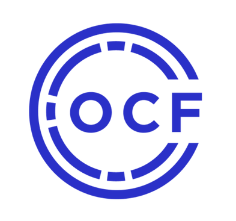

# Open Cap Table Format (OCF)



## What is OCF?

OCF (or **O**pen **C**ap Table **F**ormat) is an open source data standard for company
capitalization data developed by the [Open Cap Table Coalition](https://opencaptablecoalition.com)
to enable the easy and accurate exchange and use of company capitalization information through a
standardized format.

OCF is a JSON-based format, wherein individual objects required to describe a company cap table are
stored in JSONs that match our OCF JSON Schemas. Our reference implementation suggests storing these
JSONs in a specific set of files in a zip archive, but OCF-compatible data could be provided via API
as well. Please see our documentation for more details on JSON Schema, OCF's schemas or how to use
them.

|                                              Useful links |                                                              |
| --------------------------------------------------------: | ------------------------------------------------------------ |
| [Primary Website](https://www.opencaptablecoalition.com/) | Sharable landing site for OCF and the Coalition              |
|           [Medium Page](https://medium.com/@opencaptable) | Past announcements related to OCF and the Coalition          |
|                          [PROJECTS.md](/docs/PROJECTS.md) | Collection of public projects in the OCF ecosystem listed in |

## Create and validate an OCF export

The `ocf` command in `@open-captable/faker` turns supplied field values into schema-validated OCF
objects. With Node.js 22 or later, install the CLI and inspect the fields for a stakeholder:

```sh
npm install --global @open-captable/faker
ocf describe STAKEHOLDER
```

In a new directory, create an issuer and a stakeholder, then assemble an export as of December
31, 2025. The `object` command reads JSON from stdin and writes one validated record to stdout.
Append more records to `records.jsonl` as needed.

```sh
echo '{"id":"issuer-1","legal_name":"Example Inc.","formation_date":"2020-01-01","country_of_formation":"US"}' \
  | ocf object ISSUER > issuer.json
echo '{"id":"person-1","name":{"legal_name":"Alex Lee"},"stakeholder_type":"INDIVIDUAL"}' \
  | ocf object STAKEHOLDER >> records.jsonl

ocf validate records.jsonl
ocf export records.jsonl --issuer issuer.json --as-of 2025-12-31 --out ./export
ocf validate ./export
```

The export directory contains `Manifest.ocf.json` and a typed file for the stakeholder. Directory
validation checks each referenced file against its schema and verifies its checksum.

The bundled schemas work offline. To select a different schema source, pass `--ocf-version 1.2.0`
for a hosted release, `--schema-ref <branch-tag-or-commit>` for a GitHub snapshot, or
`--schema-dir ./schema` for a local OCF checkout. Use the same source for authoring, export, and
validation.
[CLI reference](https://github.com/Open-Cap-Table-Coalition/Open-Cap-Format-OCF/tree/main/packages/faker)

## Documentation

We have extensive, auto-generated documentation available on our
[documentation page](https://open-cap-table-coalition.github.io/Open-Cap-Format-OCF/). The documents
are automatically updated with every update to OCF.

You can find samples in our repo in the samples folder, or check out our tutorials (again, through
the documentation) to see how to get started with OCF and download complete, sample OCF cap tables.

## OCF Schema

OCF's schema is defined in our JSON Schemas, which can be found in the /schema folder of our
repository. All of our documentation is automatically generated from these source files, so they
should remain in sync.

## Contributors (alphabetical)

Please see the Open Cap Table Coalition Website or our GitHub Code Contributors List.
